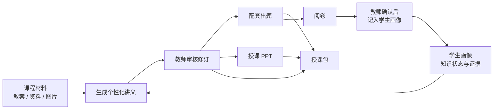

# 知页 · 面向授课的个性化讲义、出题与阅卷系统

基于 VLM + RAG 的教师备课原型：根据**课程材料**、**学生画像**和**本次授课要求**生成教师可直接修改使用的讲义，并围绕同一份讲义完成配套出题、授课课件、阅卷，以及把阅卷结果记回学生画像。

> 本机单进程原型，学生均为虚拟数据。讲义、题目、课件和评分都由模型生成，程序检查只核对结构与编号，内容正确性和教学效果须由教师复核。

## 功能一览

| 页面 | 能做什么 |
| --- | --- |
| 讲义工作台 | 选择备课副本和学生，设置授课时长、详略、题量和本次讲解安排，生成个性化讲义；阅读、修订、按章节调整、对照与导出 |
| 授课准备（讲义工具栏） | **配套出题**（题目与讲义讲法一致）、**生成授课 PPT**（可编辑 PPTX，可单页微调）、**导出授课包**（教师手册 + 学生练习 + 课件） |
| 出题 | 按备课副本、学生水平、难度和题型生成练习题，学生版 / 教师版分别导出 |
| 阅卷 | 上传学生作答（图片 / PDF / Word），按题组答案或上传答案逐题建议评分，结果按知识点记入学生画像 |
| 学生画像 | 管理学生档案与学习证据，批量导入 CSV，一键「为该学生备课」 |
| 课程材料 / 上传资料 | 建立备课副本（目标、教案、知识点），上传文档并收录到知识点，图片由视觉模型识读 |
| 生成记录 | 讲义、出题、阅卷记录，后台任务，固定输入对照实验 |
| 系统设置 | 配置并测试语言模型、视觉模型、嵌入模型 |

## 核心流程



设计原则：

- **输入冻结、可追溯**：每次生成先保存完整请求和 SHA-256 再发送，失败可按原字节重试；历史记录不随资料或画像变化而改变。
- **教师确认**：模型永远不直接修改学生画像，证据和状态变化都要教师逐条确认。
- **图文分工**：图片由独立视觉模型识读成文字，语言模型只接收解析文字。
- **检查不等于正确**：程序检查结构、篇幅和引用编号，学科正确性、来源支持和教学适配由教师判断。

## 快速开始

### 1. 环境要求

- Python 3.12+、PostgreSQL 13+（本机连接即可）
- 一个 OpenAI 兼容的模型服务，推荐[阿里云百炼](https://help.aliyun.com/zh/model-studio/first-api-call-to-qwen)：一个 API Key 即可调用语言、视觉和嵌入模型
- 可选：Node.js（运行前端回归测试）；Windows + PowerPoint + Ollama（PPT 渲染页视觉审查）

### 2. 安装与配置

Linux / macOS：

```bash
python3 -m venv .venv
.venv/bin/python -m pip install -r requirements.txt
cp .env.example .env
```

Windows PowerShell：

```powershell
py -3.12 -m venv .venv
.\.venv\Scripts\python.exe -m pip install -r requirements.txt
Copy-Item .env.example .env
```

编辑 `.env`，至少填写模型密钥（`QWEN_API_KEY`、`VLM_API_KEY`）和数据库连接 `DATABASE_URL`。各项说明见下文[配置](#配置)。

### 3. 启动

Linux / macOS：

```bash
./run_demo.sh
```

Windows PowerShell：

```powershell
.\.venv\Scripts\python.exe -X utf8 demo\init_db.py
.\.venv\Scripts\python.exe -X utf8 demo\app.py
```

打开 <http://127.0.0.1:5055>，在终端按 Ctrl+C 停止。启动时会初始化专用数据库 `lecture_demo_prototype`：库不存在且账号有建库权限时自动创建，已有数据不会被清空。没有建库权限时先由管理员创建：

```bash
sudo -u postgres createdb --owner="$USER" lecture_demo_prototype
```

修改 `.env` 后需重启服务。到「系统设置」点击各模型的「测试」确认能实际调用。

### 4. 五分钟上手

1. **讲义工作台**：选择「大学概率：贝叶斯推导与先验敏感性（进阶任务）」和学生「小唐」，点击「生成个性化讲义」，约 1 分钟完成。
2. 阅读讲义，查看正文上方的程序检查摘要，点击 `[M11]` 等编号核对来源；需要修改时点「编辑与审核」另存 R1。
3. 在工具栏「授课准备」中点击**配套出题**（10 题、混合难度）和**生成授课 PPT**（12 页）。
4. 点击**导出授课包**，下载 ZIP：教师授课手册、学生练习、课件和清单。
5. 学生作答后，在**阅卷**页选择该题组作为答案来源并上传作答，完成后在「记入学生画像」逐条确认证据。

不想调用真实模型时，可启动离线沙盒：所有模型回复都是固定测试响应，数据写入临时 schema，不影响正式数据。

```bash
.venv/bin/python demo/tests/serve_workspace_fixture.py   # 打开 http://127.0.0.1:5056
```

## 配置

所有配置在本地 `.env`（已被 git 忽略），示例见 [.env.example](.env.example)。

| 变量 | 说明 |
| --- | --- |
| `DATABASE_URL` | PostgreSQL 连接，库名必须是 `lecture_demo_prototype`；密码认证写成 `postgresql://用户:密码@127.0.0.1:5432/lecture_demo_prototype` |
| `QWEN_BASE_URL` / `QWEN_MODEL` / `QWEN_API_KEY` | 语言模型：讲义、出题、PPT、阅卷评分。百炼示例：`https://dashscope.aliyuncs.com/compatible-mode/v1`、`qwen3.8-max` |
| `QWEN_TIMEOUT_SECONDS` | 单次模型调用等待上限，30—600 秒，默认 600 |
| `VLM_BASE_URL` / `VLM_MODEL` / `VLM_API_KEY` | 视觉模型：上传图片识读、阅卷识读。实测 `qwen3.8-flash` 对看不清的内容会如实标注 |
| `QWEN_EMBEDDING_MODEL` / `_BASE_URL` / `_API_KEY` | 嵌入模型（向量检索，选填）；地址和密钥留空时沿用语言模型通道 |
| `PPT_AESTHETIC_BASE_URL` / `PPT_AESTHETIC_MODEL` | PPT 视觉审查（选填，仅 Windows + PowerPoint + 本机 Ollama），其他环境自动跳过 |
| `PORT` | 服务端口，默认 5055，仅监听本机 |

## 项目结构

```text
.
├── run_demo.sh              # 启动脚本：检查依赖 → 初始化数据库 → 启动服务
├── requirements.txt         # Python 依赖
├── .env.example             # 配置示例
├── project_map.md           # 模块关联与数据流（开发者文档）
├── demo/                    # 应用本体（Flask）
│   ├── app.py               # 入口：讲义生成、上下文、导出与各模块注册
│   ├── schema.sql           # PostgreSQL 表结构；init_db.py 初始化与种子数据
│   ├── prompts.py, prompts/ # 提示词与版本（讲义、出题、PPT）
│   ├── quizzes.py           # 出题与配套出题
│   ├── presentations.py     # 授课 PPT（ppt_*.py、pptkit_export.py 负责渲染）
│   ├── packages.py          # 授课包导出
│   ├── grading.py           # 阅卷与证据草稿
│   ├── profiles.py          # 学生画像与证据；roster_import.py 批量导入
│   ├── catalog.py           # 备课副本；uploads.py / vision.py 上传与图片识读
│   ├── retrieval.py         # SQL / 向量取材；embed.py 嵌入客户端
│   ├── reviews.py           # 修订与审核；quality.py 程序检查
│   ├── templates/, static/  # 前端页面、脚本与样式（原生 JS，无构建步骤）
│   └── tests/               # 单元与集成测试、离线沙盒 serve_*_fixture.py
├── docs/                    # 功能说明与专题文档
├── tools/ppt-kit/           # 项目内 PPT 排版引擎
├── assets/ppt-templates/    # PPT 模板与预览
├── experiments/             # 2026-10-12 固定输入对照实验
└── artifacts/               # 阅卷示例文件
```

运行时数据写在 `.runtime/`（已忽略）：上传库、阅卷库、PPT 审查记录和导出的授课包。

## 测试

```bash
.venv/bin/python -m unittest discover -s demo/tests -v
```

测试在专用库中创建临时 schema 并在结束后清理，不修改正式数据，也不调用真实模型；装有 Node.js 时会同时运行前端行为回归。当前完整 311 项通过（2026-11-05）。

## 文档

| 文档 | 内容 |
| --- | --- |
| [docs/features.md](docs/features.md) | 各页面功能、限制与设计细节（讲义、画像、检索、出题、PPT、授课包、阅卷、任务队列、实验） |
| [project_map.md](project_map.md) | 模块职责、调用关系、数据流和数据存储，修改代码前先看 |
| [docs/image-lecture-workflow.md](docs/image-lecture-workflow.md) | 图片识读接入讲义的操作与边界 |
| [docs/ppt-template-integration.md](docs/ppt-template-integration.md) | PPT 语义版式、模板适配与版本兼容 |
| [demo/prompts/README.md](demo/prompts/README.md) | 提示词版本与实际输入结构 |
| [docs/archive/](docs/archive/) | 2026-10-21 的 VLM + RAG 早期规划稿，仅作历史参考，不代表当前实现 |
| [experiments/2026-10-12-bayes](experiments/2026-10-12-bayes/summary.md)、[demo/VERIFICATION.md](demo/VERIFICATION.md) | 历史对照实验结果与早期工程验证 |

## 当前状态

- 已实现：讲义生成与审核、配套出题、授课 PPT、授课包、阅卷记入画像、学生资料批量导入，均有自动化测试，并用真实模型（qwen3.8-max）完整跑通过一次。
- 已知问题：模型生成的讲义常短于建议篇幅；题目和讲义中仍会出现模型的数学错误，需要教师逐题核对。
- 尚未完成：当前版本的有 / 无画像对照、VLM 与检索的消融实验，以及独立教师评审；没有这些数据前，不能声称节省备课时间或提升学习效果。
