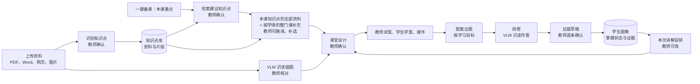
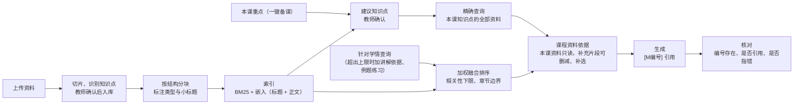

# 顶层设计

更新日期：2026-11-26。本文说明系统为什么这样设计：选题怎么拆，遵循哪些原则，整体怎么分层，RAG、VLM、个性化三条主线各自怎么落地，关键决定是怎么一步步定下来的，用什么证据检验，还缺什么。各页面的行为见 [features.md](features.md)，模块与代码见 [project_map.md](../project_map.md)，评测数据见 [scale-data.md](scale-data.md)。

## 1. 选题怎么拆

选题是「基于 VLM + RAG 的个性化讲义生成、出题与阅卷」。教师备一节课、上完课再批改，实际要回答三个问题：

- **讲什么、依据什么**：依据是这门课的资料（教材、课件、讲义，多为 PDF，带公式和插图）。这是 RAG 要解决的。
- **讲给谁**：这个班、这名学生现在每个知识点掌握到哪一步。这是个性化要解决的。
- **学得怎么样**：课后检测、批改作业，作业常是照片和扫描件；批改结果再回到对学生的判断。这里要用 VLM 识读，再由阅卷把结果写回画像。

选题里的每个词在系统里的位置：

| 选题里的词 | 在系统里是什么 | 输入 | 输出 |
| --- | --- | --- | --- |
| 讲义生成 | 先做课堂设计，再写教师详案；学生学案、授课课件从同一份设计排版 | 备课（目标、知识点、教案）、课程资料、学生画像、授课设置 | 可编辑的教师详案（带资料引用）、学案、课件 |
| 出题 | 配套出题（按讲义和学习目标出课后检测）和按备课出题 | 讲义及其课堂设计、画像 | 学生版和教师版题组，每题对应知识点和学习目标 |
| 阅卷 | 识读作答，按参考答案给建议分和错因，整理成证据 | 作答图片、PDF、Word，题组答案 | 逐题建议分，按知识点的证据草稿 |
| RAG | 从整门课的资料里检索与本课相关的片段，作为讲义的依据 | 上传并确认过的资料 | 带编号的资料片段，讲义里的 `[M编号]` |
| VLM | 把图片变成可以核对的文字 | 资料里的插图，学生作答的照片和扫描件 | 识读文字（讲义里的 `[V编号]`）、作答文本 |
| 个性化 | 用学生画像决定讲什么、讲多深、怎么分层 | 每个知识点的掌握状态和证据 | 本次讲解安排，一对一或分层的讲法，针对学情检索到的资料 |

**三条主线在「知识点」上汇合。** 资料按知识点入库，诊断按知识点记录，备课勾选知识点，题目按知识点出，阅卷结果按知识点写回画像。知识点是整个系统的公共坐标：同一个知识点下的资料服务于所有勾选它的备课，一份备课里记的诊断，其他备课也读得到。

系统不做的事：不替教师上课；不自动诊断学生，画像只在教师确认后改变；不训练模型。这是单机原型，没有登录认证和公网部署；演示和评测用的学生都是虚拟数据。

## 2. 设计原则

后面每一个设计决定，都能对应到下面五条中的一条。

1. **模型起草，教师决定。** 凡是会影响学生或长期数据的地方，都停下来让教师确认：资料里识别出的知识点、课堂设计（默认开启）、阅卷结果记入画像。检索取到的资料片段在生成前列出，教师可以删减或补选。模型永远不直接改学生画像。
2. **先冻结，再调用。** 发给模型的请求只序列化一次，先存下请求和它的 SHA-256，再发送同样的字节；生成记录同时保存当时的材料、画像和检索结果。之后资料或画像再改，历史讲义不变；失败可以按原字节重试。
3. **引用可以核对。** 讲义用 `[M编号]` 引课程资料，`[V编号]` 引图片识读；编号不存在的讲义不保存为成功；页面上点开编号，看到的是生成当时的原文。
4. **程序能做的不交给模型。** 题目、板书、提问由程序从课堂设计排进正文，所以讲义、学案、课件逐字一致；图由模型给出数据、程序校验后绘制；算式由程序用精确分数复算；时间、题量、编号由程序核对。模型负责写，程序负责查。
5. **先量再改。** 改生成方式，用固定评测集的同一组课前后对照；检索用带标注的问题评；讲义好不好最终由教师盲评。程序检查只能说明结构和编号，不能说明内容正确。

## 3. 总体架构

### 3.1 教学闭环

图里每个「教师确认」都是一个停顿点：模型的结果先作为草稿保存，教师看过、改过、确认后才进入下一步；「教师可改」「可删减」的地方不强制停下，但生成前都列在页面上。

### 3.2 分层

| 层 | 内容 | 实现 |
| --- | --- | --- |
| 交互 | 讲义工作台、课程与班级、出题、阅卷、生成记录、系统设置；每页跟随顶部选的「课程 › 班级」 | 原生 JavaScript 单页，无构建；Electron 桌面客户端 |
| 业务 | 组装生成上下文（画像、讲解安排、材料、图片识读）、检索、生成流水线、程序检查、出题、阅卷、导出 | Flask 单进程，生产用 waitress |
| 模型 | 语言模型、视觉模型、嵌入模型三个通道，分别配置，都走 OpenAI 兼容接口；语言模型调用共用一个并发闸门（默认 3）和后台任务队列 | 实测用阿里云百炼：qwen3.8-max、qwen3.8-flash、text-embedding-v4；也可接本机 Ollama 等服务 |
| 数据 | 课程、班级、学生、知识点、资料与片段、画像与证据、生成记录与讲义版本 | PostgreSQL；上传原件与图片识读在 `uploads.sqlite3`，阅卷在 `grading.sqlite3` |

### 3.3 核心数据

- **课程 → 班级 → 学生**。学生档案跨课程共享，同一门课里一名学生只属于一个班。
- **知识点库**按课程建立。名称只差全角半角、空格或大小写的视为同一个知识点，避免同一内容建出两份。
- **资料**挂在知识点上，带来源页码；**片段**是检索的单位，记下类型（定义、定理、例题、练习、正文）、小标题、向量和索引格式。
- **学生画像**：每个知识点一个掌握状态（需要补充、部分掌握、已掌握、未知）和一串证据（作业、测验、课堂观察、教师复核；阅卷结果由教师选定来源后记入）。改状态必须附证据，由教师确认，并写明理由。
- **生成记录**：冻结的请求及其 SHA-256、上下文快照、检索记录、程序检查报告、用量；**讲义**的修订另存为 R1、R2，原稿不动。

## 4. RAG：课程资料怎么进入讲义

1. **入库**：上传的 PDF、Word、文本和网页先抽取正文并清洗（如还原 PDF 里被读错的斜体字母），按页或标题切片，跳过目录、去掉页眉页脚；模型参照本课程已有的知识点名称识别出细粒度知识点，每个对应一段页码范围。识别结果只是草稿，教师逐条改名、调整范围、合并后确认，才写入资料。
2. **索引**：资料按结构切成约 500 字的片段，例题连同它的解答整块保留（最长 900 字）。关键词索引（BM25）和嵌入向量都用「资料标题 + 片段正文」，因为标题带知识点的中文名称，而上传的课件正文常是英文。索引按需增量更新，资料、分块方式或嵌入模型变了才重算。
3. **检索用在哪里**：本课要讲的知识点由教师确认，它们的资料用精确查询整份交给模型，这是保底；检索只做两件精确查询做不了的事。一是**找知识点**（一键备课）：教师只写本课重点，检索在整个知识点库里排序，建议勾选哪些知识点，每个附上依据的片段，教师增删后建课。二是**按学情补充**：学生的错因常落在别的知识点上（假设检验课上把条件概率的方向弄反），「针对学情」查询在整门课里找相关片段补进来，后面还没学的章节除外。本课资料超过上限（16000 字）时，才用「讲解依据」「例题练习」两组查询在本课资料里选节选，每个知识点至少留一段。
   下面是整门课检索（`hybrid`）的做法，上面两处用的是同样的索引、融合和下限：范围是整门课的资料，不只是所选知识点，这样前面学过的内容和其他章节的例题也能用上。三组查询各有用途和名额：讲解依据（本课目标与知识点）、例题练习（所选知识点的例题与练习）、针对学情（薄弱知识点的近期表现与备注，只在有画像时）。每组分别按关键词和语义排序，用加权的倒数排名融合；只取通过相关性下限的片段，宁可取不满也不凑数；每个所选知识点至少保留一段。嵌入服务不可用时只按关键词排序，并说明原因，讲义照常生成。
4. **教师查看与调整**：工作台的「课程资料依据」按用途列出取到的片段和备选片段，教师可以删掉不合适的，也可以补选。资料在教师看过之后被修改或删除的，任务会被退回，不会悄悄用上新内容。
5. **进入生成**：同一份资料的片段合并为一条材料，沿用 `[M编号]`，并写明用途；提示词规定怎么引用，以及改编例题时要注明出处。按环节写详案时，每个环节只附设计里引用的材料和与本环节最相关的几份。
6. **核对**：引用了不存在的编号，讲义不保存；取到的资料一份都没被引用时提醒；某行引用的材料几乎不相干、另一份却明显更接近时，提示可能引错了编号。评测时另用模型逐行判断引用是否被材料支持。

**四种取用方式并存。** 页面默认是「本课知识点的全部资料 + 整门课补充」（`anchored`）；精确 SQL（取所选知识点的全部资料）是接口默认，保证历史对照可复现；整门课检索（`hybrid`）和向量检索保留作对照。选择的理由：本课讲什么由教师确认，这部分要完整、可复现，用精确查询；检索擅长的是在教师说不清在哪里的资料里找，所以用来找知识点和按学情补充。只按检索取材时，本课资料只给排在前面的几段（4 节课里每节 9 段），读不全，名额也不随知识点数调整（3 个知识点的课少了一个知识点的例题）；资料少时排序又不改变结果。资料多到超过上限时，才需要在本课资料里「选」。关键词和语义融合，是因为只按向量排序时，中文问句配英文课件、公式名这类字面查询不稳。

## 5. VLM：图片怎么变成可用的文字

两个入口：

- **资料里的图**（插图、公式截图、题目照片）：视觉模型识读成文字，教师核对后最多选 4 条进入讲义输入，正文用 `[V编号]` 引用；记录识读模型、图片指纹和识读请求的指纹。
- **阅卷**：学生作答的照片、扫描件、手写 PDF 按整页渲染后识读，再由语言模型按参考答案逐题给建议分和错因；看不清或答案冲突的题标为待核对，不计分。

**关键决定：视觉模型和语言模型分开，语言模型只收文字。** 2026-10-21 的规划稿设想让生成模型直接看图，到 2026-10-25 实现改为现在的分离方式（规划稿见 [archive/](archive/)）。原因：

- 识读结果是文字，教师看得到、改得了，看错的地方不会悄悄进入讲义；
- 讲义请求里不放图片字节，「序列化一次、SHA-256 可复算」的冻结方式不受影响，请求也小；
- 两个通道可以分别更换模型，互不影响。

代价是语言模型看不到图的版面和空间关系；资料一侧的 PDF 只抽取内嵌图片，不整页渲染。

## 6. 个性化：学生画像怎么进入讲义

- **画像来自证据**：每个知识点的状态都由证据支撑，证据来自作业、测验、课堂观察和阅卷。教师确认后才改变状态；也可以记下证据、保留原判断。
- **本次讲解安排**：生成前按知识点把诊断和最近证据整理成建议讲法，教师可以逐条修改；这里的修改只用于这一份讲义，不写回长期画像。过期证据、观察时间缺失都会提醒；状态未知不当作薄弱。
- **两种对象**：一名学生时按一对一辅导写（不写巡视、小组、举手，前测按答对答错分两条路）；全班时用班级画像（按知识点的人数分布、匿名证据样例，状态由规则汇总），讲法分层。
- **进入模型的方式**：画像和讲解安排进入课堂设计；检索的「针对学情」查询来自薄弱知识点的近期表现。请求里学生姓名一律换成「该生」，发给嵌入服务的查询也不带姓名。
- **可对照**：同一份备课可以「无画像」生成，去掉个体诊断、讲解安排和学情查询，检索也只用共同的目标和知识点，用来检验个性化到底有没有用。
- **闭环**：配套出题的题号对应知识点和学习目标；阅卷后按知识点整理成证据草稿，教师逐条确认后写回画像，下一次讲义就用上新的诊断。

## 7. 生成流水线：先设计，再写

为什么不让模型一次写完：实测一次写完的讲义只有要求篇幅的三分之一；改成分章节写以后篇幅上来了，但讲义、课件、题组各有一套题目和符号，对不上。

所以默认分三步（2026-11-14 起）：

1. **课堂设计**：一次调用，输出结构化的设计（JSON）：重点难点、学习目标及检验它的题、按分钟排的环节、全课的题目（前测、例题、练习、作业）、板书和符号表。程序核对结构、时间合计、题量、目标与检验题是否对应、算式和图；结构错了整份重做一次，只有提醒时只让模型改有问题的部分。
2. **教师确认设计**（默认开启）：可以改分钟数、重点和题目，也可以写一句意见让模型重做。批量生成或在高级设置里关掉时跳过这一步。
3. **按环节写详案**：只有新授、例题和重点环节调用模型（可并行），其余环节直接用设计里的内容；题目、板书、提问由程序从设计排进正文。

学生学案、教师用书和授课课件都从同一份设计排版，所以三份材料的题目和符号一致。之后的配套出题按学习目标分配题目，检查是否照抄了课上做过的题、符号是否与学案一致。

## 8. 质量保证与评测

三层：

- **程序检查**（每次生成都跑）：结构与编号、课堂时间与题量、算式复算、图的数据是否自洽、概率值范围、表达提醒、引用是否指错材料。结果只是提示，不证明内容正确。
- **教师审核**：修订另存为新版本，记录问题、依据、理由和用时；标记「教师已审核」前必须逐项确认检查表。
- **评测**：固定评测集（12 节课，分 dev 和 holdout，在一次性的隔离库里按页面的接口生成）、有无画像对照、材料取用方式对照、检索标注评测、模型逐行引用评审，以及给教师的盲评材料。

每个问题现在的证据：

| 要回答的问题 | 怎么量 | 现在的结果 | 缺口 |
| --- | --- | --- | --- |
| 检索准不准 | 带标注的问题，看正确知识点的片段是否排进前 k | 真实课程（97 份资料）前 3 命中 96.5%；扩展语料两章 92%、96% | 真实课程的问题由编码助手编写，未经教师审核 |
| 一键备课建议的知识点对不对 | 评测集 12 节课的标题和目标当作重点，与课上勾选的知识点比较；真实课程 57 条问题 | 采用的规则在 dev、holdout 上把正确知识点全部勾上，勾选的里正确的占 70%、88%；真实课程上 94% 的正确知识点被勾上 | 评测集标题里就有知识点名称，偏于容易；holdout 在定规则前看过一次；没有教师写的重点 |
| 用资料对讲义有没有帮助 | 同 4 节课，各种取用方式和不提供材料各生成一份；程序统计、引用评审、盲评 | 不给材料时模型没有编造编号。默认方式与精确 SQL（同一份代码重跑）给的资料逐份相同，tokens 445764 对 395632，程序检查未通过 11 项对 9 项，引用评审「支持」79% 对 85%。两次精确 SQL 运行之间「支持」就差 85% 对 66%，此前整门课检索 87% 对 66% 的差距落在这个范围里 | 每种方式每节只有一份，差别分不清是方式还是波动；评审模型与写讲义的同一家族；没有教师评分 |
| 个性化有没有用 | 同 4 节课有画像、无画像各一份；盲评 | 程序统计没有一致的差别 | 没有教师评分；有画像的讲义容易被认出 |
| VLM 有没有用 | 尚无方案 | 未做消融 | 待设计 |
| 成本 | tokens 与用时 | 2026-11-18 以后评测集 dev 的运行：每节课约 5 万—16 万 tokens、2—4.5 分钟（qwen3.8-max，默认写作方式） | — |

数据和局限见 [scale-data.md](scale-data.md)。

## 9. 部署与工程约束

- **单机**：一台电脑上运行服务和 PostgreSQL；桌面客户端的安装包自带 PostgreSQL 和 Python，教师只需安装和配置模型。服务只接受本机访问（检查 Host 和 Origin），密钥只存在本机。
- **模型可替换**：三个通道都是 OpenAI 兼容接口，可以用云服务，也可以用本机的 Ollama、LM Studio 等；系统设置里能一键探测本机服务或导入常见客户端的配置。
- **后台任务**：生成在队列里运行，有并发上限；服务重启后未完成的任务可以按原输入重试；限流和服务繁忙时自动重发，超时不重发。
- **测试**：服务端测试 543 项（前端行为回归也在其中，用 Node 运行），桌面客户端另有自己的测试；持续集成先查语法错误、未使用的导入和未定义的名字，再在 PostgreSQL 容器里跑全部测试。

## 10. 关键决定的演进

| 时间 | 决定 | 原因 |
| --- | --- | --- |
| 2026-10-12 | 建立固定输入对照实验（3 类画像 × 有、无画像 × 2 次） | 让「个性化有没有用」可以对照，而不是只看单份输出 |
| 2026-10-21—10-25 | 图片由独立视觉模型识读，语言模型只收文字（10-21 的规划稿设想直接看图） | 识读可核对，请求可冻结和复算 |
| 2026-11-10 | 加入分章节写作（先列大纲，再逐章写） | 一次写完的篇幅只有要求的三分之一 |
| 2026-11-14 | 默认改为先做课堂设计，再按环节写 | 分章节后讲义、课件、题组的题目和符号对不上 |
| 2026-11-17 | 建立固定评测集；向量检索保留为可选，默认精确 SQL | 改动要能量；在所选知识点内排序不改变结果 |
| 2026-11-18 | 学生姓名不发给模型；课堂设计有提醒时局部修正 | 隐私；整份重做那一次中位数 77 秒，局部修正降到 8—13 秒 |
| 2026-11-26 | 页面默认改为整门课检索，生成前教师可以删减或补选资料片段；加两项引用检查 | 资料多时需要「选」；真实课程上前 3 命中 96.5%，四节课对照里 tokens 更少、程序检查未通过的项目更少 |
| 2026-11-26（同日稍后） | 加一键备课（写本课重点，检索建议知识点，教师核对后建课）；页面默认改为「本课知识点的全部资料 + 整门课补充」，整门课检索保留为可选 | 只按检索取材时本课资料读不全，取到的本课以外片段一段也没被引用；本课讲什么已由教师确认，这部分该完整给，检索留给精确查询做不了的找知识点和按学情补充。评测集 8 节课上，新方式给模型的资料与精确 SQL 逐份相同 |

## 11. 还没有解决的问题

- **没有教师评分。** 有无画像、三种材料取用方式的盲评材料已经备好（`.runtime/evalset/20261118-024034/blind/`、`experiments/2026-11-26-rag/blind/`），还没有教师评分。在此之前，不能说个性化或检索让讲义更好用，也不能说节省了备课时间。
- **VLM 的作用没有单独检验**，消融实验还没有方案。
- **按学情补充的好处还没有在评测集里出现。** 评测集 8 节课的学情命中都落在本课自己的资料里，一段补充也没有取到；只有专门加了一条指向前面知识点的备注的那节课取到了，讲义的前测题改编自补充的例题，但没有专门讲备注里的错误。真实课程上，「针对学情」命中哪些片段还受候选范围影响：「期望与方差」一例加上章节边界后，命中的本课资料和补充片段反而不如不设边界时对路，因为关键词分数、排名融合和相关性下限都是在候选范围内相对计算的。
- **一键备课的建议规则只在合成课程上定过。** 评测集的课题标题里就有知识点名称，偏于容易；holdout 在定规则前看过另一条规则的成绩；真实课程的问题由编码助手编写。还没有教师亲手写的「本课重点」来检验。
- **超出上限时的节选没有生成过讲义。** 真实课程上只核对过取材（每个知识点都留下了资料），没有看节选后的讲义。
- **引用核对有盲区。** 例题某一步的数字来自例题材料，却只引了概念材料，这类情况程序检查发现不了，评测里两种方式各有 6 行。
- **学科正确性靠教师。** 程序只复算能识别的算式，推导和答案是否正确、是否适合这名学生，仍要教师判断。
- **演示和评测的学生都是虚拟数据**，没有真实课堂的效果数据。

## 12. 相关文档

| 文档 | 内容 |
| --- | --- |
| [features.md](features.md) | 每个页面的行为、限制和设计细节 |
| [project_map.md](../project_map.md) | 模块职责、调用关系、数据流和存储 |
| [scale-data.md](scale-data.md) | 评测集、检索评测、生成对照的数据与局限 |
| [image-lecture-workflow.md](image-lecture-workflow.md) | 图片识读怎么进入讲义 |
| [demo/prompts/README.md](../demo/prompts/README.md) | 提示词版本与模型实际收到的输入 |
| [user-guide.md](user-guide.md) | 按操作顺序写的使用指南 |
| [archive/](archive/) | 2026-10-21 的 VLM + RAG 规划稿，只作历史参考 |
