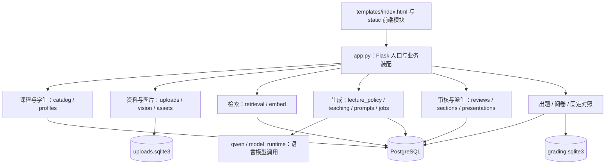
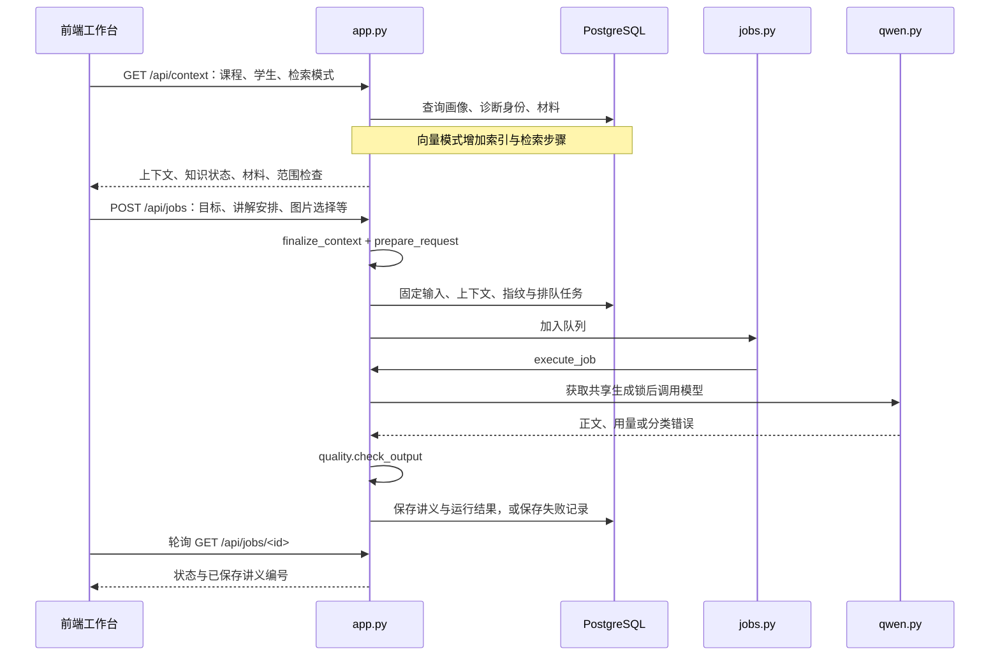
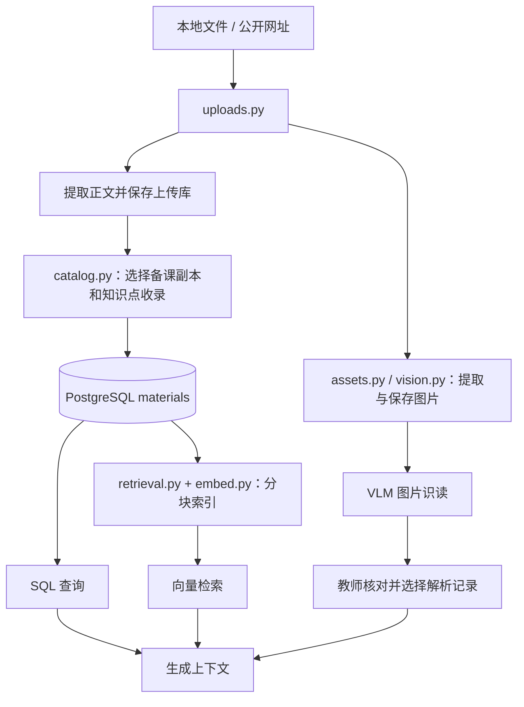

# 项目模块关联图

更新日期：2026-11-03。本文依据当前源码整理，用于定位模块职责、调用关系和数据流；模块存在不代表模型服务当前在线或已完成教学效果验收。

## 1. 项目入口与整体结构

项目是一个 Flask 教学工作空间，前端使用 HTML、CSS 和原生 JavaScript，通过 HTTP API 访问后端。页面以 URL hash 切换，业务脚本共享部分全局状态，没有独立的前端框架或构建服务。

图中连线表示业务依赖；具体存储归属见第 7 节。阅卷使用 SQLite，出题和当前固定对照使用 PostgreSQL。

| 入口或目录 | 职责与关联 |
| --- | --- |
| `demo/app.py` | Flask 应用入口；建立数据库访问、课程上下文、生成锁及任务队列，注册各业务模块的 API。 |
| `demo/templates/index.html` | 页面与弹窗的 DOM 结构；加载 `demo/static/` 下的脚本和样式。 |
| `demo/static/` | 页面导航、表单、请求、轮询、预览与审核交互。 |
| `demo/init_db.py`、`demo/schema.sql` | 初始化专用 PostgreSQL 数据库、业务表及种子数据。 |
| `run_demo.sh` | Bash 启动入口：检查依赖和 `.env`，运行初始化，再启动 `demo/app.py`。其中虚拟环境路径使用 Unix 形式。 |
| `requirements.txt`、`.env.example` | Python 依赖与配置字段说明；真实配置由 `.env` 提供。 |
| `docs/` | 图片讲义、VLM/RAG 和 PPT 集成等方案与说明。 |
| `demo/tests/` | 功能测试、隔离 UI 服务及测试素材。 |
| `experiments/` | 历史实验输入、输出及评审记录；与当前数据库内固定对照区分。 |
| `tools/ppt-kit/`、`assets/ppt-templates/` | 项目内 PPT 排版工具与模板资源。 |

## 2. 前端页面与后端接口

导航由 `static/navigation.js` 控制。当前主要页面如下：

| 页面 / 路由 | 主要前端模块 | 后端关联 |
| --- | --- | --- |
| 讲义工作台 `#workbench` | `app.js`、`jobs.js`、`teaching.js`、`lecture-workflow.js`、`lesson-settings.js`、`vision.js` | `/api/bootstrap`、`/api/context`、`/api/jobs`；课程、画像、教学安排、检索与图片证据共同进入生成流程。 |
| 学生画像 `#profiles`、`#profiles/new`、`#profiles/<id>` | `student-roster.js`、`profiles.js` | `/api/students`、学生 profile/evidence 接口；对应 `profiles.py` 及 `app.py` 中的学生入口。 |
| 课程材料 `#materials`、`#materials/new`、`#materials/<key>` | `course-manager.js` | `/api/course-tasks` 及 materials/copy 接口；对应 `catalog.py`。 |
| 上传资料 `#uploads` | `uploads.js`、`vision.js` | `/api/uploads`、`/api/vision/*`；对应资料保存、图片提取与识读。 |
| 出题 `#quizzes` | `quizzes.js` | `/api/quizzes`；对应 `quizzes.py`。 |
| 阅卷 `#grading` | `grading.js` | `/api/grading`；对应 `grading.py`。 |
| 生成记录 `#records` 及子路由 | `jobs.js`、`traces.js`、`quizzes.js`、`grading.js`、`evaluation.js` | 讲义任务、生成输入、出题、阅卷和固定对照的历史接口。 |
| 系统设置 `#settings` | `model-settings.js` | `/api/health`、`/api/model-settings` 及 test 接口；对应配置检查、保存和连接测试。 |

讲义上的附加入口：

| 前端模块 | 关联模块与功能 |
| --- | --- |
| `reviews.js` | `reviews.py`：原稿与修订版本、具体问题、教师检查表、审核状态。 |
| `traces.js` | `runs.py` 与 `app.py`：实际生成输入、运行状态、参数及失败重试。 |
| `profile-comparison.js` | `profiles.py`：生成时画像与当前画像的差异。 |
| `lecture-comparison.js` | `comparisons.py`：同目标讲义、版本及章节差异。 |
| `section-editor.js` | `sections.py`：按章节生成修改建议并接受为新修订。 |
| `presentations.js` | `presentations.py`：把指定讲义版本转换成授课 PPT；右侧单页微调、修改前后对照、采用为新课件及候选恢复。 |
| `layout.js` 与各 CSS 文件 | 分栏宽度、响应式布局、弹窗滚动及打印展示。 |

### 前端共享状态与事件

- `app.js` 定义 `$`、`api`、`el` 等公共工具，并维护课程、学生、当前上下文、讲义结果及 busy 状态；后加载的业务脚本会直接使用它们。
- `workspace-context`：课程或上下文变化后同步其他页面的选择器。
- `lecture-version-changed`：讲义或忙碌状态变化后，更新 PPT 等入口和教学设置摘要。
- `quiz-history-open`、`grading-history-open`、`experiment-history-open`：导航进入相应记录页后加载历史。
- `navigation.js` 负责显示页面；学生与课程详情脚本也监听 `hashchange` 处理各自子路由。

因此修改脚本加载顺序、DOM ID 或共享函数时，要同时检查依赖它的页面和弹窗。

## 3. 后端模块职责与依赖

### 3.1 课程、学生与材料

| 模块 | 职责 | 主要关联 |
| --- | --- | --- |
| `courses.py` | 内置课程任务、示例及课程类别判断。 | 被 `catalog.py`、`prompts.py`、`quality.py` 等使用。 |
| `catalog.py` | 合并内置与持久化课程；创建、修改和复制备课副本；关联上传正文。 | 读取 `courses.py` 和 `uploads.read_upload()`；写入课程、知识点、别名与材料表。 |
| `profiles.py` | 学习证据、掌握状态、学生说明、修改历史及画像对照。 | 为 `app.py` 提供上下文；供教学安排与初始化使用。 |
| `uploads.py` | 本地文件与公开网址导入、正文提取、保存、预览及下载。 | 使用 `assets.py` 提取图片，并调用 `vision.py` 的图片保存与路由注册能力。 |
| `assets.py` | 图片抽取、归一化、字节指纹，以及图片资产和运行关联的数据库辅助函数。 | 被上传与图片识读使用；PostgreSQL 资产表和 SQLite 上传图片存储是不同通道。 |
| `vision.py` | 图片保存、VLM 识读、解析记录，以及按选择提取图片文字证据。 | 使用图片处理工具与模型错误类型；读取上传库；生成时由 `app.py` 调用 `selected_evidence()`。 |

重要关联：复制课程会建立独立知识点与材料编号，通过 `knowledge_aliases` 显式关联来源知识点的诊断身份。同名知识点不自动合并。历史讲义保留生成时的快照。

### 3.2 检索与讲义生成

| 模块 | 职责 | 主要关联 |
| --- | --- | --- |
| `embed.py` | Qwen 和 Ollama 嵌入客户端、向量归一化及测试用嵌入实现。 | `app.py` 默认实例化 `QwenEmbedder`；供 `retrieval.py` 的索引与搜索流程调用。 |
| `retrieval.py` | 正文分块、索引更新、查询构建、相似度检索和材料格式转换。 | 读取 `materials`，保存 `material_chunks`；支持 pgvector 后端与数组扫描回退。 |
| `lecture_policy.py` | 本次讲解安排、证据提示与输入字符预算，完成上下文整理。 | 依赖画像信息；由生成入口和当前固定对照使用。 |
| `teaching.py` | 授课时长、详略、篇幅及教师要求等字段的校验和提示构造。 | 被 `prompts.py`、`quality.py`、`evaluation.py` 使用。 |
| `prompts.py`、`prompts/*.md` | 根据任务组织模型消息，生成固定请求正文、版本号及 SHA-256。 | 读取教学设置及课程类别；不同提示文件支持讲义、出题、章节改写、PPT 等任务。 |
| `jobs.py` | `JobQueue`：单进程有界队列、排队取消、原输入重试及重启恢复。 | 调用注入的执行函数；使用 `runs.py` 保存输入与状态。 |
| `qwen.py` | 语言模型传输、响应解析、用量与安全错误分类。 | 接收 `PreparedRequest`，使用 `model_runtime.py` 的运行配置。 |
| `model_runtime.py` | 模型通道共用的地址、密钥、超时等传输设置。 | 供语言模型及设置模块使用。 |
| `quality.py` | 目标范围、篇幅、结构、引用编号及特定知识内容的程序检查。 | 在生成与修订保存时使用；检查不能代替教师对正确性和引用支持的判断。 |
| `runs.py` | 固定输入、实际调用记录、失败分类、结果与讲义保存。 | 成功讲义和对应运行结果在同一事务内提交。 |

### 3.3 审核、派生输出与评测

| 模块 | 职责 | 主要关联 |
| --- | --- | --- |
| `reviews.py` | 版本读取、问题记录、教师修订与审核历史。 | 调用 `quality.py`；写入时锁定讲义并检查事件版本，避免覆盖并发修改。 |
| `comparisons.py` | 只读讲义候选、版本与章节比较。 | 使用 `reviews.py` 读取已保存版本；以历史数据为依据。 |
| `sections.py` | 冻结某个章节和上下文，生成修改建议，再接受为新修订。 | 经共享 `TASKS` 执行；调用提示、模型、质量检查、审核与运行记录模块。 |
| `rendering.py` | 安全 HTML/Markdown 展示和图片证据文字附录。 | 为讲义导出提供渲染能力；导出入口及 DOCX 等格式装配仍在 `app.py`。 |
| `presentations.py` | 固定讲义版本，构造 PPT 请求，校验模型输出并提供预览和下载；单页候选生成与采用/放弃。 | 与讲义、章节改写共用 `TASKS`；使用 `generation_runs` 快照和 PPT 渲染模块。 |
| `ppt_aesthetics.py`、`render_ppt_slides.ps1` | 保存送审 PPTX，调用本机 PowerPoint 渲染，向本机 Ollama 发送实际像素并校验逐页视觉建议。 | `presentations.refine_presentation()` 在生成中等待内部审查；独立审查队列及 SQLite，模型调用共用 `vision.VLM_LOCK`。 |
| `quizzes.py` | 题目生成、输出校验、独立队列与导出。 | 使用课程上下文、提示和模型；任务保存到 PostgreSQL，与其他语言任务共用生成锁。 |
| `grading.py` | 上传试卷和参考答案，提取作答，生成逐题批改建议。 | 复用上传/图片识读与模型能力；结果保存在独立 SQLite 库，共用语言模型生成锁。 |
| `evaluation.py` | 冻结当前版本的有/无画像对照输入，排队执行并汇总实际记录。 | 使用生成上下文、教学安排、提示及共享任务队列；结果存 PostgreSQL。 |
| `experiment.py` | 基于文件 manifest 的历史固定实验准备与执行工具。 | 复用提示及应用能力，面向 `experiments/` 中的历史文件工作流。 |
| `model_settings.py` | 分通道查看、测试并原子保存本地模型配置。 | 注册 `/api/model-settings*`；写入 `.env`，配置应用时机以该接口和页面提示为准。 |

### PPT 渲染链

```mermaid
flowchart LR
    L[已保存讲义及选定版本] --> P[presentations.py]
    P --> M[prompts.py + qwen.py]
    M --> S[ppt_story.py：语义页面契约]
    S --> A[pptkit_export.py：课堂适配器]
    T[ppt_templates.py + 模板资源] --> A
    A --> K[tools/ppt-kit/pptkit：版式与构建]
    A --> X[pptx_export.py：原生 PPTX 工具与兼容导出]
    K --> O[可编辑 PPTX]
    X --> O
    O --> R[ppt_aesthetics.py：保存送审副本]
    R --> PNG[render_ppt_slides.ps1：PowerPoint 导出 PNG]
    PNG --> V[本机 Ollama：实际图片视觉审查]
    V --> DB[(reviews.sqlite3：逐页结果)]
    DB --> FIX[presentations.refine_presentation：按反馈修改]
    FIX --> M
    FIX --> FINAL[选定更优版本后提交成功：仅展示最终 PPT]
    FINAL --> EDIT[用户指定页码和修改要求]
    EDIT --> ONE[prepare_slide_edit：模型只返回目标页 JSON]
    ONE --> MERGE[replace_slide：服务端仅替换目标页]
    MERGE --> CHECK[单页渲染与内部视觉审查]
    CHECK --> CAND[保存 pending 候选：前后对照]
    CAND --> ACCEPT[采用：校验其他页不变，标记 accepted]
    ACCEPT --> FINAL
```

`ppt_story.py` 约束页面内容结构，`ppt_templates.py` 管理模板白名单和版本映射，`pptkit_export.py` 将教学语义适配到项目内排版引擎。历史导出保留相应版本兼容路径，不能把所有历史记录视为采用当前排版规则。

新建 PPT 的冻结输入设置 `ppt_export.aesthetic_review=true`，初稿导出后在生成任务内部等待全部页面视觉审查。`refine_presentation()` 根据明确问题构造 `ppt-visual-repair-v1` 语言模型请求，最多修改两轮，每轮重新校验、导出和视觉审查。按高/中/低问题权重 9/3/1 比较，只接受分数降低的候选；不改无问题页面，保留教师讲稿和来源。修改无改善、输出无效或服务异常时保留最后一个有效且更优的版本。全部步骤结束后才将最终内容提交 PostgreSQL 并标记成功，前端只显示最终 PPT，不展示报告或审查按钮；教师审核状态不变。重试仍冻结初始请求，修订请求及响应另存本地审查目录，最终 `response_metadata.aesthetic_refinement` 记录轮数及采用结果。

内部诊断 API（不在页面展示）：`POST /api/presentations/<run_id>/aesthetic-review` 接收 `{}` 审查全篇，也可提供不重复且在范围内的整数 `pages`；同路径 `GET` 读取最新记录；`GET /api/presentations/<run_id>/aesthetic-review/<identity>/slides/<page>` 校验课件、审查记录和页码关联后返回渲染图。沿用课件成功状态和输入完整性检查。生成中的内部审查直接调用管理器，不依赖这些仅适用于成功课件的接口。

审查独立读取 `PPT_AESTHETIC_BASE_URL`、`PPT_AESTHETIC_MODEL`，默认本机 Ollama 与 `qwen3.5:9b`，只支持本机 HTTP 地址且须声明视觉能力。页面转 RGB、最长边不超过 1440 后以 PNG/base64 发送，记录实际发送字节的 SHA-256、模型与提示版本；内部诊断接口的图片为 PowerPoint 原始渲染图。

### 单页微调与课件版本

单页微调代码位于 `demo/presentations.py` 的 `prepare_slide_edit()`、`replace_slide()`、`execute_presentation()` 和对应路由；前端复用 `demo/static/presentations.js`、`presentations.css` 及 `templates/index.html` 中 `ppt-edit-panel`。宽屏在预览右侧固定面板，窄屏移到预览上方。每页「修改这一页」同步右侧页码；采用后仅替换该页预览 DOM，下载地址切换到新运行 ID。

| API | 数据流与限制 |
| --- | --- |
| `POST /api/presentations/<run_id>/slide-edits` | 接收整数 `page`、1—1500 字 `instruction`、`base_sha256`；冻结原课件、目标页、原版运行 ID 和模型请求，提交共用队列。 |
| `GET /api/presentation-edits/<run_id>` | 候选成功后返回目标页 `before/after`、原课件 ID、页码和 `pending/accepted/discarded` 状态。 |
| `POST /api/presentation-edits/<run_id>/accept` | 事务内锁定候选；校验原课件快照、输入指纹、标题、页数和所有非目标页一致，幂等采用。候选运行 ID 成为新的可下载课件 ID，原记录不改写。 |
| `POST /api/presentation-edits/<run_id>/discard` | 幂等标记放弃，保留可追溯记录；已采用与已放弃状态不能互转。 |

`GET /api/presentations/<run_id>` 新增 `deck_sha256` 和可选 `edit={parent_run_id,page}`。未采用候选拒绝普通课件预览、下载和继续微调；已采用记录可继续生成下一次单页候选。课件历史列表只纳入已采用的微调版本；待处理、失败或放弃的候选通过后台任务恢复，未改变原课件或讲义。

不新增数据库表：`generation_runs.context.ppt_slide_edit` 保存 `base_deck`、`base_sha256`、`parent_run_id`、`page` 和 `instruction`，沿用原 `ppt_export` 模板及讲义来源；`response_metadata.edit_state` 保存候选处理状态，`operation=ppt_slide_edit`。`generation_jobs.parent_run_id` 关联提交来源（重试时仍沿用队列的失败父任务含义，课件来源以 context 为准）。模型请求版本为 `ppt-slide-edit-v1`，只发送目标页及目标、来源和页面标题背景；只接受单页对象。内容校验和导出使用完整合并后的 JSON，内部审图与最多两轮自动修订限定于目标页。重新导出完整 PPTX 不会重新生成其他页内容；文件的生成记录来源备注随新版本更新。

## 4. 主流程：生成一份讲义

关键边界：

- 输入先冻结，再发送相同请求正文；历史输入和材料不会随着当前资料修改而改变。
- SQL 模式按知识点取材料；向量模式在当前知识点范围内构建查询并选取分块，保存检索信息。
- 无画像模式不向模型提供个体诊断和个体教学安排。
- 图片先经 VLM 识读；语言模型使用所选识读文字及来源快照，不直接接收这一步的原始图片。
- 生成讲义不会自动改变学生长期掌握状态，状态更新需要明确证据及教师确认。
- 按原输入重试复用冻结输入；重新生成读取当前上下文，两者含义不同。

## 5. 上传资料如何进入讲义

上传库和课程材料库相互独立，但当前版本已有显式收录接口：`POST /api/course-tasks/<key>/materials` 接收 `upload_id` 和 `knowledge_id`，读取上传正文并写入 PostgreSQL，材料来源使用 `upload:<id>`。上传动作本身不等于资料已经进入当前课程。

没有可收录正文的图片资料通过图片识读通道加入。图片引用 `[V编号]` 与文字材料引用 `[M编号]` 分开核查；`[K编号]` 用于定位本次知识点讲解安排。

## 6. 任务、锁和服务生命周期

| 对象 | 用途 | 与其他模块的关系 |
| --- | --- | --- |
| Flask 服务 | 提供页面与 API，默认仅监听 `127.0.0.1:5055`。 | 由 `app.py` 主入口启动，关闭浏览器不会停止 Python 服务。 |
| `TASKS = JobQueue(...)` | 讲义、章节改写、PPT 和固定对照的共用排队通道。 | `execute_job()` 根据上下文分派到讲义、`execute_section()` 或 `execute_presentation()`。 |
| `QUIZZES = QuizQueue(...)` | 独立出题队列。 | 与其他语言任务共用 `GENERATION_LOCK`。 |
| 阅卷工作线程 | 文档提取与批改任务。 | 状态存 SQLite，语言模型调用使用同一个生成锁。 |
| `GENERATION_LOCK` | 限制同一进程内语言生成任务的并发调用。 | 不代表所有 VLM/Embedding 网络请求都由该锁统一串行化。 |
| `AestheticReviews` | PPT 审查单活动任务、最多 3 个等待任务，拒绝同课件重复排队。 | 生成执行器持有 `GENERATION_LOCK` 等待内部审查及修改；实际审图与上传识图共用 `vision.VLM_LOCK`，不会在持有视觉锁时再申请语言锁；逐页持久化，部分成功为 `partial`，全部失败为 `failed`。 |

主入口启动时调用阅卷、讲义任务、出题及固定对照的恢复函数，对未完成记录做中断处理；不会自动重发旧模型请求。后台线程和记录恢复不等于操作系统定时任务。部署方式按本机单进程设计理解，不能直接视为多 worker 分布式队列。

PPT 审查在管理器首次使用时将旧 `queued/running` 记录标记为 `interrupted`，保留已有逐页结果，不自动重发；生成任务按原有重启恢复规则中断，用户可通过原输入重试重新生成。

## 7. 数据存储对应关系

### PostgreSQL：教学业务主库

表结构以 `demo/schema.sql` 为准：

| 表 / 表组 | 关系与使用模块 |
| --- | --- |
| `students`、`knowledge_points` | 学生及知识点主数据；课程目录、画像和生成流程的共同基础。 |
| `course_tasks`、`knowledge_aliases` | 持久化备课任务与副本诊断身份映射；由 `catalog.py` 管理，生成上下文读取。 |
| `student_knowledge`、`learning_evidence`、`knowledge_state_history`、`student_profile_history` | 当前知识状态、证据与历史；由 `profiles.py` 管理。 |
| `materials`、`material_chunks` | 知识点对应的原材料与嵌入分块；由课程收录、SQL 查询和 RAG 使用。 |
| `lectures`、`generation_runs`、`generation_jobs` | 保存讲义、冻结输入、运行结果及排队状态；由生成、任务、派生输出与追溯模块使用。 |
| `lecture_revisions`、`lecture_issues` | 修订正文、审核及具体问题；与已保存讲义关联。 |
| `lecture_experiments`、`lecture_experiment_cells` | 当前固定对照的实验与各输入单元；关联生成记录。 |
| `material_assets`、`generation_run_assets` | 图片资产及运行绑定的表结构与辅助接口；不要与上传库实际保存的图片记录混为一组。 |
| `quiz_jobs` | 出题任务、固定输入及结果。 |

### SQLite 与文件

| 位置 | 内容 | 主要模块 |
| --- | --- | --- |
| `.runtime/uploads.sqlite3` | `uploads` 原资料及正文、`upload_notices` 解析提示、`upload_images` 图片、`image_analyses` 识读记录。 | `uploads.py`、`vision.py`；`catalog.py` 显式读取正文收录。 |
| `.runtime/grading.sqlite3` | `grading_jobs`：阅卷状态、提取文字、参考答案、模型输入及批改结果。 | `grading.py`。 |
| `.runtime/ppt-aesthetics/reviews.sqlite3` | `reviews`：课件运行 ID、任务状态、模型、PPTX 指纹、页码、逐页结果、错误及时间。 | `ppt_aesthetics.py`。 |
| `.runtime/ppt-aesthetics/<review_id>/` | `source.pptx` 送审副本、`render.json`、`slide-<page>.png`，以及发生修改时的 `repair-request.json`、`repair-response.json`（含请求指纹和用量）；不进入 PostgreSQL。 | `ppt_aesthetics.py`、`render_ppt_slides.ps1`。 |
| `.env` | 数据库与模型通道的实际配置。 | 启动加载、模型运行与设置模块；文档不记录真实密钥。 |
| `demo/seed.json`、`demo/university_seed.json` | 初始教学数据。 | `init_db.py`。 |
| `assets/ppt-templates/` | PPT 模板、预览与许可证等资源。 | `ppt_templates.py`、PPT 导出适配器。 |
| `experiments/` | 历史文件式实验记录。 | `experiment.py`；当前固定对照主要存数据库。 |

## 8. 修改时的关联检查

| 想修改的功能 | 优先查看 | 同时核对 |
| --- | --- | --- |
| 增加页面或导航 | `index.html`、`navigation.js`、对应 JS/CSS | DOM ID、脚本顺序、共享事件及手机布局。 |
| 课程或备课副本 | `catalog.py`、`course-manager.js`、`courses.py` | 知识点身份、材料关联、学生匹配与复制测试。 |
| 学生画像 | `profiles.py`、`student-roster.js`、`profiles.js` | 诊断证据、版本冲突、历史快照及画像对照。 |
| 上传与识图 | `uploads.py`、`assets.py`、`vision.py` | SQLite 结构、正文收录入口、图片指纹与识读选择。 |
| RAG | `retrieval.py`、`embed.py`、`app.get_context()` | 索引过期检测、知识点范围、检索快照及无画像对照。 |
| 讲义结构与篇幅 | `lecture_policy.py`、`teaching.py`、`prompts.py`、提示文件 | `quality.py`、输入预算、历史版本和各导出格式。 |
| 后台生成与重试 | `jobs.py`、`app.py`、`runs.py`、`jobs.js` | 队列取消、共享锁、失败状态及重启恢复。 |
| 审核与局部改写 | `reviews.py`、`sections.py` 及对应 JS | 版本锁、问题记录、引用检查和另存修订。 |
| PPT 输出 | `presentations.py`、`ppt_story.py`、`pptkit_export.py` | 模板版本、`pptx_export.py`、项目内 ppt-kit 与 PPT 测试。 |
| PPT 内部审查与单页微调 | `presentations.py`、`ppt_aesthetics.py`、`render_ppt_slides.ps1`、`presentations.js` | 成功提交前完成审查、目标页范围、两轮上限、非目标页不变校验、候选采用/放弃、历史恢复、VLM 锁、SQLite、`test_ppt_aesthetics.py` 和 `test_presentations.py`。 |
| 出题 / 阅卷 | `quizzes.py` / `grading.py` 及对应 JS | 各自存储、模型调用锁、重试与导出。 |
| 模型配置 | `model_settings.py`、`model_runtime.py`、`qwen.py`、`embed.py`、`vision.py` | 语言、视觉、嵌入通道区别；密钥遮蔽及配置生效时机。 |

对应测试可从 `demo/tests/test_<功能>.py` 查起，例如 `test_preparation_workflow.py`、`test_profiles.py`、`test_uploads.py`、`test_vision.py`、`test_retrieval.py`、`test_courses_jobs.py`、`test_generation_runs.py`、`test_teaching_sections.py`、`test_presentations.py`、`test_quizzes.py`、`test_grading.py`、`test_current_evaluation.py`。`serve_*_fixture.py` 是隔离 UI 验证入口，与正式服务区分。

维护本文时，以实际 import、`register_*()` 装配、API 调用与数据库读写为依据；功能或存储发生变化后，应同步更新流程图和表格。
