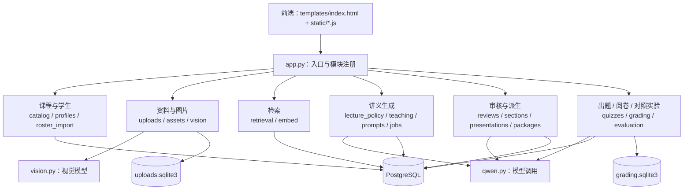
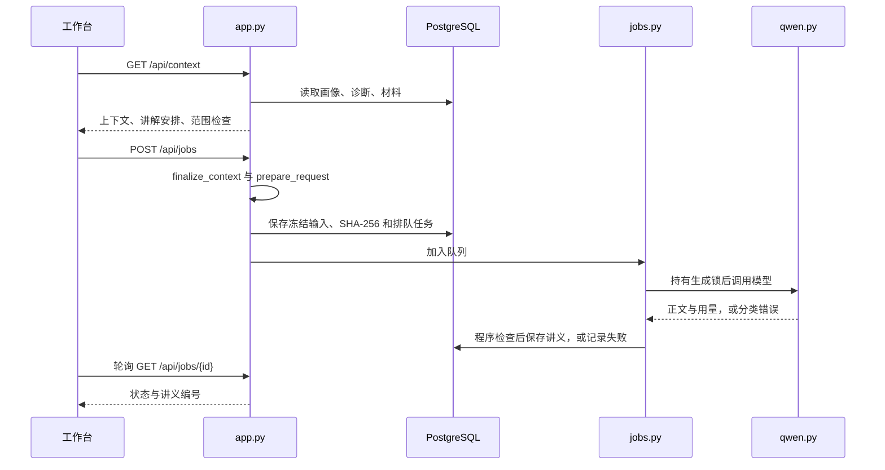
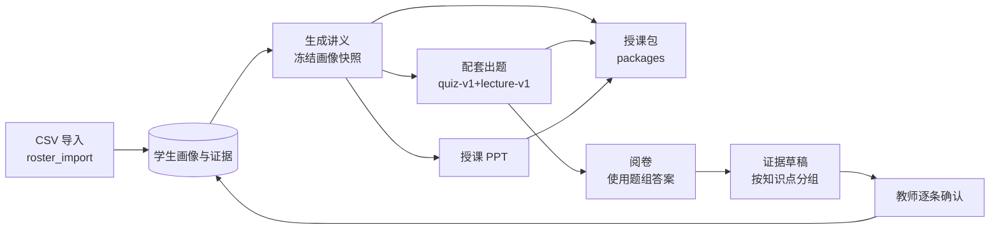
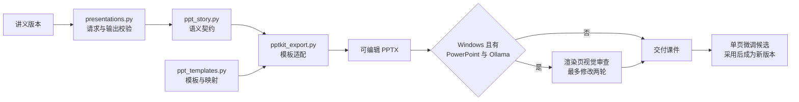
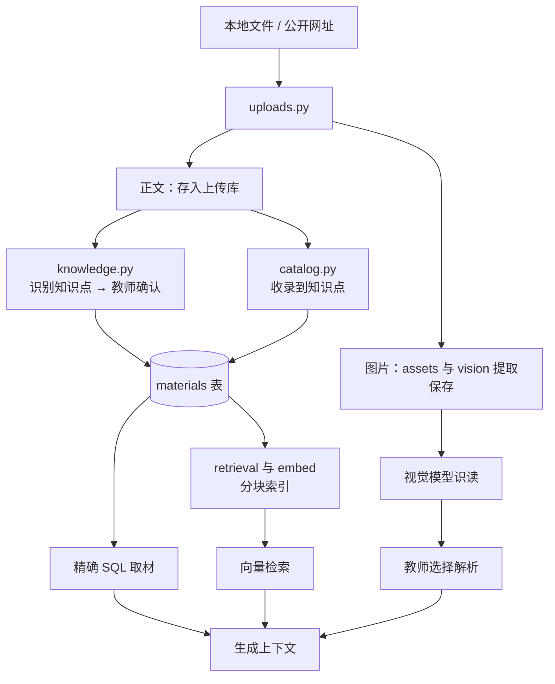

# 项目模块关联图

更新日期：2026-11-13。面向开发者：说明模块职责、调用关系、数据流和存储，修改代码前先确认影响范围。功能行为见 [docs/features.md](docs/features.md)。

## 1. 整体结构

Flask 单进程应用，前端为 `templates/index.html` 加原生 JavaScript 模块（无框架、无构建），通过 HTTP API 访问后端；页面用 URL hash 切换。

| 入口 | 说明 |
| --- | --- |
| `run_demo.sh` | 检查依赖与 `.env`，运行 `demo/init_db.py`，再启动 `demo/app.py`（默认 127.0.0.1:5055） |
| `demo/app.py` | 讲义上下文与生成、导出、学生接口；创建共享任务队列与生成锁，注册其余模块的路由 |
| `demo/schema.sql`、`demo/init_db.py` | 表结构与增量初始化；种子数据在 `seed.json`、`university_seed.json` |
| `demo/tests/` | 单元与集成测试；`serve_*_fixture.py` 为固定响应的离线沙盒（5056 端口） |

## 2. 页面与前端模块

| 页面（路由） | 前端脚本 | 主要接口 |
| --- | --- | --- |
| 讲义工作台 `#workbench` | `app.js`、`jobs.js`、`live.js`、`batch.js`、`teaching.js`、`lecture-workflow.js`、`lesson-settings.js`、`vision.js` | `/api/bootstrap`、`/api/context`、`/api/jobs`、`/api/jobs/batch`、`/api/job-status`、`/api/jobs/<id>/stream`、`/api/figures/render` |
| 出题 `#quizzes` | `quizzes.js` | `/api/quizzes`（`lecture_id` 为配套出题） |
| 阅卷 `#grading` | `grading.js`、`grading-evidence.js` | `/api/grading`、`/api/grading/<id>/evidence-drafts` |
| 顶部课程 / 班级切换（全部页面） | `context.js` | `/api/courses` |
| 课程 `#courses`（全部课程）、`#materials`（备课）、`#materials/resources`（课程资料）、`#materials/knowledge`（知识点库）、`#materials/classes`（班级）、`#materials/<key>`（备课详情） | `course-page.js`、`course-manager.js`、`knowledge.js`、`uploads.js`、`vision.js` | `/api/courses*`（含 `/api/courses/<id>/knowledge`）、`/api/knowledge/*`、`/api/course-tasks*`、`/api/uploads*`、`/api/vision/*` |
| 班级与画像 `#profiles`（班级画像）、`#profiles/students`、`#profiles/resources`（班级资料）、`#profiles/new`、`#profiles/import`、`#profiles/<id>` | `class-page.js`、`student-roster.js`、`profiles.js`、`roster-import.js`、`uploads.js` | `/api/classes*`、`/api/students*`、`/api/students/import*` |
| 生成记录 `#records/...` | `jobs.js`、`traces.js`、`evaluation.js` | `/api/generation-runs*`、`/api/lecture-experiments*` |
| 系统设置 `#settings` | `model-settings.js` | `/api/health`、`/api/model-settings*` |
| 开始使用引导（讲义工作台顶部） | `getting-started.js` | `/api/health`、`/api/courses`、`/api/courses/<id>/knowledge` |

讲义工具栏与弹窗：

| 前端脚本 | 后端模块 | 功能 |
| --- | --- | --- |
| `reviews.js` | `reviews.py` | 版本切换、问题记录、编辑与审核、程序检查面板 |
| `section-editor.js` | `sections.py` | 按章节生成候选并另存修订 |
| `traces.js` | `runs.py` | 查看生成输入、失败重试 |
| `profile-comparison.js`、`lecture-comparison.js` | `profiles.py`、`comparisons.py` | 画像对照、讲义比较 |
| `quizzes.js`（配套出题） | `quizzes.py` | 以当前讲义版本出题 |
| `presentations.js` | `presentations.py` | 生成课件、预览、单页微调 |
| `packages.js` | `packages.py` | 导出授课包，显示已有练习与课件数量 |

前端约定：`app.js` 定义 `$`、`api`、`el` 和共享状态（`lastResult`、`busy`、`topics` 等），后加载的脚本直接使用。`context.js` 提供 `window.workspaceScope`（当前课程、班级、`classOf()`、`refresh()`、`ready`），选择记在浏览器 `localStorage`。跨模块通过事件同步：`scope-changed`（课程或班级切换，`detail` 为来源；`refresh` 表示只是数据刷新）、`lecture-version-changed`（讲义或忙碌状态变化）、`workspace-context`（备课目录变化）、`grading-record-shown`（阅卷记录显示）。讲义对象为 `#student` 的值：学生编号或 `class:<班级编号>`，由 `window.lectureTarget()` 转成请求字段。资料区 `#resource-workspace` 只有一份，`uploads.js` 按路由移入课程或班级的资料标签。修改 DOM ID、脚本顺序或共享函数时，要同时检查依赖它的页面。`usability.css` 之后依次加载 `rich.css`（公式、表格、图、实时预览、批量窗口）和 `motion.css`（动效，最后加载）。`app.js` 里的 `renderMarkdown` 负责公式（KaTeX，位于 `static/vendor/katex/`）、表格和图占位，所有讲义预览共用。`pwa.js`、`sw.js`、`manifest.webmanifest` 提供可安装外壳，`/api/` 不缓存。

## 3. 后端模块

**课程、学生与资料**

| 模块 | 职责 |
| --- | --- |
| `courses.py` | 预置课程任务、预置课程与演示班级（`PRESET_COURSES`）、课程类别判断 |
| `classes.py` | 课程 → 班级 → 学生：课程与班级增改、选课（一门课程每名学生只在一个班）、班级画像汇总（`class_state` 规则）、班级讲义上下文、一次性迁移 `ensure_course_structure`；知识点库同名规则 `name_key` / `library_names`（全角半角、空格、大小写不计），备课、识别确认、新增改名和 CSV 导入共用 |
| `catalog.py` | 合并预置与自建备课（每份属于一门课程，`course_id`）；课程备课从知识点库勾选（`knowledge_ids`），新名称加入知识点库；复制；把课程或班级资料收录为知识点材料（班级资料带 `class_id`） |
| `knowledge.py` | 课程知识点库与知识点识别：按页或标题切片、去页眉页脚、找编号标题（规则），模型细分（`prompts/knowledge-recognition-v2.md`，附库中已有名称以便沿用），草稿 `knowledge_drafts`，教师确认后写入知识点与资料片段；后台队列 `KnowledgeQueue` 与其他模型调用共用并发闸门 |
| `profiles.py` | 学习证据、掌握状态、修改历史与画像对照；证据写入须教师确认 |
| `roster_import.py` | 学生名单与学习证据 CSV 的预览、指纹校验和整批事务导入；证据按名称对应课程知识点库（`classes.library_ids`），指纹只覆盖文件涉及的学生与知识点 |
| `uploads.py`、`assets.py`、`vision.py` | 文件与网址导入、正文与图片提取、图片规范化与指纹、视觉模型识读 |

**检索与讲义生成**

| 模块 | 职责 |
| --- | --- |
| `retrieval.py`、`embed.py` | 分块、索引、余弦排序（pgvector 可替换），嵌入客户端 |
| `lecture_policy.py` | 本次讲解安排、证据提醒、材料与上下文字符预算 |
| `teaching.py` | 授课设置校验与篇幅规则 |
| `prompts.py`、`prompts/` | 组装请求、只序列化一次并计算 SHA-256、标记提示词版本 |
| `jobs.py`、`runs.py` | 有界任务队列（多工作线程、批量额度）、取消与重试、重启恢复；运行记录与讲义同事务保存 |
| `gate.py` | 模型并发闸门：全进程共用，`MODEL_CONCURRENCY` 个额度；额度为 1 时等同原来的全局锁 |
| `sectioned.py` | 分章节生成：大纲 → 各章节单独调用（有空闲额度时并行）→ 校验、重写一次 → 拼接 |
| `repair.py` | 出题与课件的结构化输出未通过校验时，带问题自动重试一次 |
| `qwen.py`、`model_runtime.py` | OpenAI 兼容调用（含流式 SSE）、错误分类、超时 |
| `progress.py` | 运行中的实时正文（仅内存、仅显示），供 `/api/jobs/<id>/stream` 推送 |
| `quality.py` | 章节、篇幅、引用编号、范围与已知问题词语检查；新流程追加算式复算、图与公式标记 |
| `mathcheck.py` | 重算纯数字等式、把写出的解代回方程；不认识的式子跳过 |
| `figures.py` | 结构化图：校验 JSON 数据并绘制为 SVG / PNG（概率树、数轴、等式变形、函数图像、柱状对比） |

**审核、派生与评测**

| 模块 | 职责 |
| --- | --- |
| `reviews.py` | 修订版本、问题记录、审核事务与并发冲突检查 |
| `sections.py`、`comparisons.py` | 章节候选与采用；讲义与版本比较 |
| `presentations.py` | 课件请求、输出校验、导出、内部视觉审查与单页微调 |
| `ppt_story.py`、`ppt_templates.py`、`pptkit_export.py`、`pptx_export.py` | 语义页面契约、模板白名单与映射、排版适配与 PPTX 导出 |
| `ppt_aesthetics.py`、`render_ppt_slides.ps1` | PowerPoint 渲染与本机 Ollama 视觉审查（仅 Windows） |
| `packages.py` | 授课包：只读已保存记录，组装教师手册、学生练习、课件与清单 |
| `quizzes.py` | 出题、配套出题、题目校验、独立队列、导出；为阅卷提供题组答案与知识点映射 |
| `grading.py` | 阅卷任务、识读与评分校验、证据草稿 |
| `evaluation.py`、`experiment.py` | 当前版本固定对照；历史文件式实验 |
| `rendering.py`、`model_settings.py` | 安全渲染与图片附录；模型配置的查看、测试与保存 |
| `edition.py` | 正式版 / 测试版（`ZHIYE_EDITION`）与数据目录（`ZHIYE_DATA_DIR`，存放 `.env` 和 `.runtime/`，默认项目根目录）；`app.py`、`init_db.py`、`catalog.py`、`presentations.py` 共用 |
| `richdoc.py` | 导出用：LaTeX 转 Word 原生公式、图转图片、表格；`app.py` 与 `packages.py` 共用 |
| `scale/` | 可选的扩展语料、合成班级装载（`load.py`）、检索评测（`eval_retrieval.py`）和生成基准（`bench.py`） |

## 4. 关键流程

### 4.1 生成一份讲义

要点：输入先冻结再发送；向量模式在知识点范围内检索并记录命中片段；无画像模式不发送个体诊断；图片只以解析文字进入上下文；生成不修改学生状态；「按原输入重试」复用冻结字节，「重新生成」读取当前数据。

### 4.2 教学闭环

授课包与证据草稿都不调用模型；只有教师确认才写画像，「保留原判断」只记录证据。题组保存题号与知识点的映射，阅卷借此把题目归到知识点。

### 4.3 授课 PPT

新任务冻结模板 ID、模板 SHA-256、映射版本和完整请求；历史课件按原渲染版本导出。单页微调只让模型返回目标页，服务端合并后校验其他页不变。

### 4.4 上传资料进入讲义

上传不等于进入课程：识别出的知识点经教师确认后，片段以 `upload:<id>#p起-止`（PDF 页）或 `#s起-止`（文本段）写入 `materials`；也可整份显式收录（来源记为 `upload:<id>`）。课程备课勾选知识点库中的知识点，材料按知识点取用，所以同一知识点的片段服务于所有勾选它的备课。上传记录带 `course_id` / `class_id`：课程资料全班共用，班级资料收录后 `materials.class_id` 有值，`retrieval.SCOPE` 和 `scoped_materials` 只在为该班或班内学生生成时取用。引用编号：`[M编号]` 课程材料，`[V编号]` 图片解析，`[K编号]` 只用于定位本次讲解安排。

## 5. 任务队列与锁

| 对象 | 说明 |
| --- | --- |
| `TASKS`（`jobs.JobQueue`） | 讲义、章节调整、PPT、固定对照共用；工作线程数等于模型并发数，单份提交最多「并发数 + 3」个未完成任务，批量提交最多 80 个 |
| `QUIZZES`（`quizzes.QuizQueue`） | 出题独立队列，最多 4 个未完成任务 |
| 阅卷工作线程 | 每次处理一个阅卷任务，状态存 SQLite |
| `GENERATION_LOCK`（`gate.ModelGate`） | 同进程所有语言模型调用共用的并发额度（默认 3）；每个任务占一个，分章节写作再借用空闲额度 |
| `vision.VLM_LOCK` | 上传识图、阅卷识读与 PPT 视觉审查互斥 |

服务启动时把未完成的讲义、出题和对照任务标为中断、阅卷任务标为失败，不自动重发模型请求。只适用于本机单进程，不支持多 worker。

## 6. 数据存储

**PostgreSQL**（库名固定为 `lecture_demo_prototype`，表结构见 `demo/schema.sql`）

| 表 | 用途 |
| --- | --- |
| `students`、`knowledge_points`、`course_tasks`、`knowledge_aliases` | 学生、知识点、自建备课副本、副本诊断身份映射 |
| `courses`、`classes`、`class_students`、`class_profile_history`、`schema_migrations` | 课程、班级与班级特点、选课（`UNIQUE(course_id, student_id)`）、班级特点修改历史、一次性迁移记录 |
| `student_knowledge`、`learning_evidence`、`knowledge_state_history`、`student_profile_history` | 当前掌握状态、证据与历史 |
| `materials`、`material_chunks` | 课程材料与向量分块 |
| `lectures`、`lecture_revisions`、`lecture_issues` | 讲义原稿、修订与问题；班级讲义 `student_id` 为空、`class_id` 有值（`generation_runs`、`quiz_jobs` 同理） |
| `generation_runs`、`generation_jobs` | 冻结输入、运行结果、排队状态（讲义、章节、PPT 共用） |
| `quiz_jobs` | 题组任务、冻结输入与结果 |
| `lecture_experiments`、`lecture_experiment_cells` | 当前版本固定对照 |
| `material_assets`、`generation_run_assets` | 图片资产辅助表（上传图片实际存在 SQLite） |

**本地文件**（`.runtime/`，已被 git 忽略）

| 位置 | 内容 |
| --- | --- |
| `uploads.sqlite3` | 上传原件与正文、提取的图片、图片识读记录 |
| `grading.sqlite3` | 阅卷任务、提取文字、评分结果、所用题组与知识点映射 |
| `ppt-aesthetics/` | PPT 视觉审查记录、送审副本与渲染图 |
| `.env`（项目根目录，设置了 `ZHIYE_DATA_DIR` 时在该目录） | 数据库与模型配置，含密钥 |

**桌面客户端**（`desktop/`，数据目录结构）

| 位置 | 内容 |
| --- | --- |
| `database/` | 自带 PostgreSQL 的数据库文件 |
| `database-secret.json` | 数据库用户 `zhiye` 的随机密码 |
| `workspace/` | 作为 `ZHIYE_DATA_DIR`：`.env`（模型配置）与 `.runtime/` |
| `logs/client.log` | 客户端、`pg_ctl` 和服务的输出 |

## 6.1 桌面客户端

Electron 主进程启动自带的 PostgreSQL 和 Python 服务，再在窗口中打开服务页面。服务代码与网页版完全相同，客户端只通过环境变量传入数据库地址、端口、数据目录和版本。

| 文件 | 职责 |
| --- | --- |
| `src/main.js` | 窗口、菜单、启动页状态、IPC（检查发送方）、导航与权限限制、备份 / 恢复 / 更换数据目录、检查更新、安全退出 |
| `src/runtime.js` | 启动顺序：数据目录 → `Postgres` → `Backend.migrate`（`init_db.py`）→ `Backend.start`（`app.py`）；重启与停止 |
| `src/postgres.js` | 建库（`initdb`）、追加配置、`pg_ctl` 启停、连接地址 |
| `src/backend.js` | 服务环境变量（`serviceEnv`）、运行 `init_db.py` 与 `app.py`、等待 `/api/health` |
| `src/processes.js` | 清理继承的环境变量（`cleanEnv`）、运行子进程、结束进程树、Windows 短路径 |
| `src/paths.js`、`config.js`、`ports.js`、`logs.js`、`backup.js`、`policy.js` | 程序与数据位置、客户端设置、端口、日志、冷备份、导航与链接规则（均不依赖 Electron，有单元测试） |
| `src/preload.js` | 页面可用的 `window.zhiyeDesktop`：启动页多几项（状态、重试、更换目录），服务页面只有查看日志、打开数据目录、重启服务 |
| `src/launcher/` | 启动页 |
| `scripts/stage.mjs` | 准备 `build/resources`：便携 Python 及依赖、服务代码白名单（正式版不含演示数据文件）、PostgreSQL |
| `scripts/smoke.mjs`、`dist.mjs`、`dev.mjs` | 无界面冒烟测试、打包、从源码运行 |
| `electron-builder.config.cjs` | 两个版本的应用名、安装包名和安装选项 |

## 7. 修改时的关联检查

| 修改内容 | 先看 | 同时检查 |
| --- | --- | --- |
| 页面或导航 | `index.html`、`navigation.js`、对应 JS/CSS | DOM ID、脚本顺序、共享事件、窄屏布局 |
| 备课副本 | `catalog.py`、`course-manager.js` | 知识点身份与别名、材料关联、复制 |
| 学生画像 | `profiles.py`、`roster_import.py` | 证据确认路径、版本冲突、历史快照 |
| 课程与班级 | `classes.py`、`context.js`、`course-page.js`、`class-page.js` | 一门课一个班的约束、班级讲义的匿名上下文、班级资料范围、`scope-changed` 监听者、`test_classes.py` |
| 上传与识图 | `uploads.py`、`assets.py`、`vision.py` | SQLite 结构、收录接口、图片指纹 |
| 知识点库与识别 | `knowledge.py`、`knowledge.js`、`course-manager.js` 的勾选列表 | 草稿版本（`version`）与确认、同名合并、`renumber` 的章节排序、来源片段格式 `#p起-止`（`sourceHref` 据此跳页）、`test_knowledge.py` |
| 检索 | `retrieval.py`、`embed.py`、`app.get_context()` | 索引更新、知识点范围、检索快照、无画像模式 |
| 讲义结构与篇幅 | `lecture_policy.py`、`teaching.py`、`prompts.py` | `quality.py`、字符预算、历史版本 |
| 队列与重试 | `jobs.py`、`runs.py`、`gate.py`、`jobs.js` | 取消、并发额度的获取与释放、失败状态、重启恢复 |
| 分章节生成 | `sectioned.py`、`prompts/lecture-sectioned-*.md` | 冻结上下文里的 `sectioned`、章节配额与篇幅检查一致、`test_pipeline_v3.py` |
| 公式与图 | `figures.py`、`richdoc.py`、`app.js` 的 `renderMarkdown` | 网页、HTML、Word、纯文本四种输出，`prompts/lecture-format-rich-v1.md` 里的图格式 |
| 审核与章节调整 | `reviews.py`、`sections.py` | 版本锁、问题记录、引用检查 |
| PPT | `presentations.py`、`ppt_story.py`、`pptkit_export.py` | 模板版本、视觉审查、单页微调、`test_presentations.py` |
| 出题 / 阅卷 / 授课包 | `quizzes.py`、`grading.py`、`packages.py` | 冻结版本与 JSON 模式、题号映射、学生练习不含答案 |
| 模型配置 | `model_settings.py`、`qwen.py`、`vision.py`、`embed.py` | 三个通道的区别、密钥遮蔽、重启生效 |
| 正式版 / 测试版 | `edition.py`、`init_db.py`、`courses.py` 的预置课程、`index.html` 中的 `release` 分支 | 正式版空库可从零建课（`test_edition.py`）、`desktop/scripts/stage.mjs` 的文件白名单 |
| 桌面客户端 | `desktop/src/`、`desktop/scripts/` | `npm test`、`node scripts/smoke.mjs --dev`；新增服务环境变量要加进 `processes.cleanEnv` 的清理列表 |

测试按功能命名为 `demo/tests/test_<功能>.py`，例如 `test_quizzes.py`、`test_packages.py`、`test_teaching_loop.py`、`test_presentations.py`。
